<div align="center">


# Shift Control · app publicado

**O app que está online em [marloon-dev.github.io/shift-control-app](https://marloon-dev.github.io/shift-control-app/).**<br>
Escala, trabalho extra, funções e previsão do recibo para os trabalhadores portuários PORLIS/SEAL.

[](https://marloon-dev.github.io/shift-control-app/)
[](https://marloon-dev.github.io/shift-control-site/)
[](https://wa.me/351922242250)

<br>

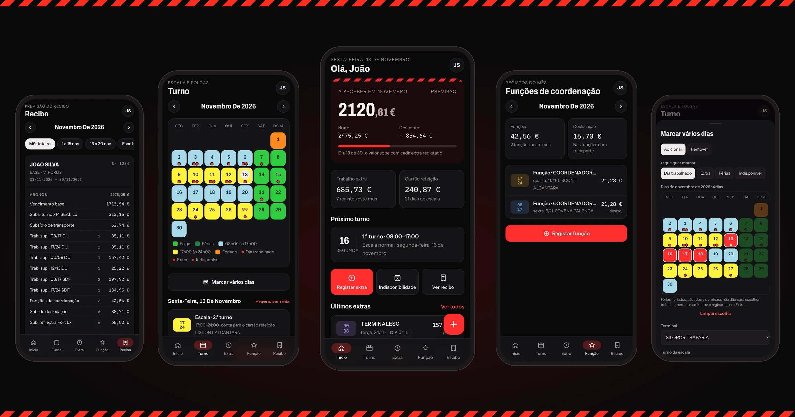

<sub>Ecrãs com dados fictícios.</sub>

</div>

<br>

> [!IMPORTANT]
> **Não edite este repositório à mão.** Cada publicação substitui todo o conteúdo.
> É gerado automaticamente a partir do código-fonte (privado) sempre que há uma versão nova.

## 📲 Como usar

| Onde | Como | Atualizações |
| --- | --- | --- |
| **Android** | Descarregar o APK no [site de instalação](https://marloon-dev.github.io/shift-control-site/#android) | Sozinhas, ao abrir o app. Quando há APK novo, o app avisa. |
| **iPhone / iPad** | Abrir [o app](https://marloon-dev.github.io/shift-control-app/) no **Safari** → Partilhar → **Adicionar ao ecrã principal** | Sozinhas, ao abrir pelo ícone |
| **Computador** | Abrir [o app](https://marloon-dev.github.io/shift-control-app/) no Chrome, Edge ou Safari (opcional: *Instalar*) | Sozinhas |

O acesso é dado pelo administrador. Entra-se com e-mail e palavra-passe.

<br>

## ✨ O que o app faz

<table>
<tr>
<td align="center" width="25%">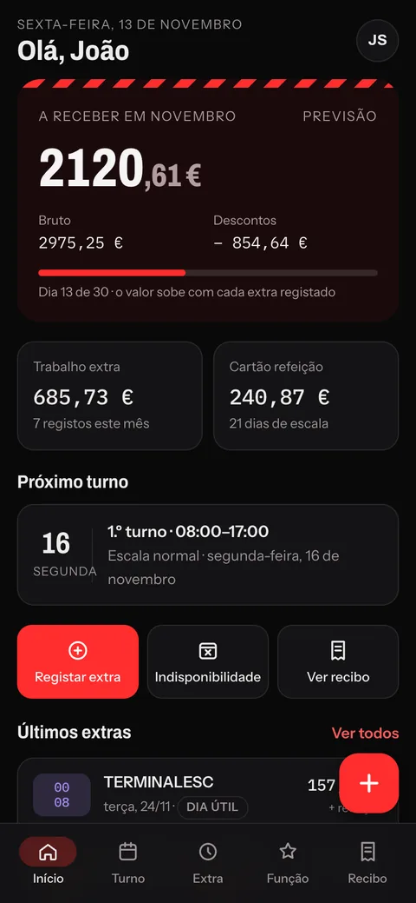<br><b>Início</b><br><sub>Quanto vai receber e o próximo turno</sub></td>
<td align="center" width="25%">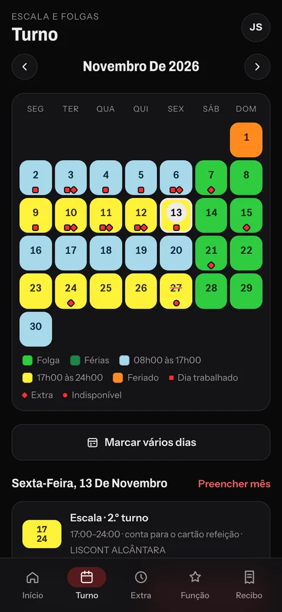<br><b>Turno</b><br><sub>Escala com cores e marcas por dia</sub></td>
<td align="center" width="25%">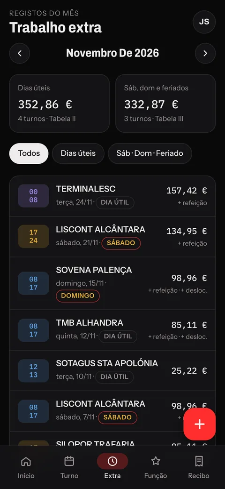<br><b>Extra</b><br><sub>Valor da tabela posto sozinho</sub></td>
<td align="center" width="25%">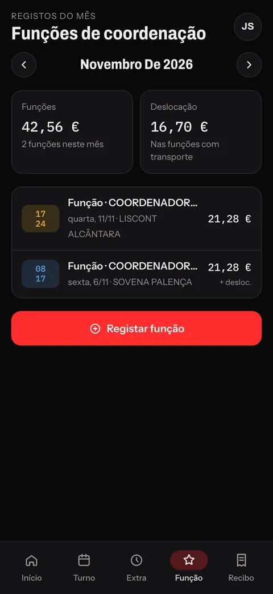<br><b>Função</b><br><sub>Coordenação paga pela diferença</sub></td>
</tr>
<tr>
<td align="center">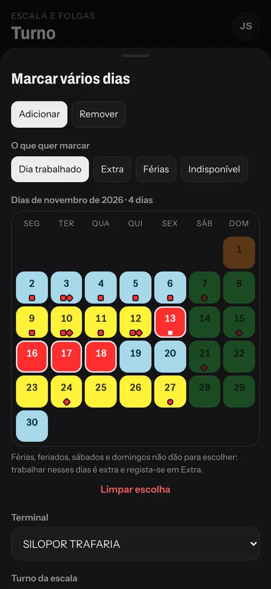<br><b>Marcar vários dias</b><br><sub>Trabalhado, extra, férias, indisponível</sub></td>
<td align="center">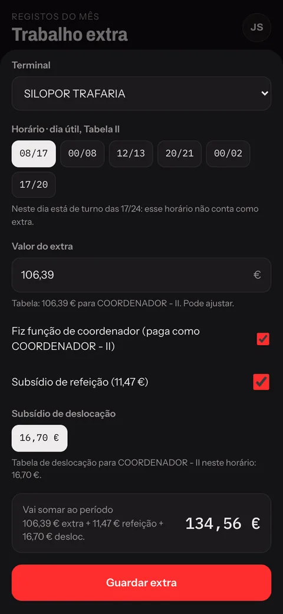<br><b>Registar extra</b><br><sub>Opção de coordenador e deslocação</sub></td>
<td align="center">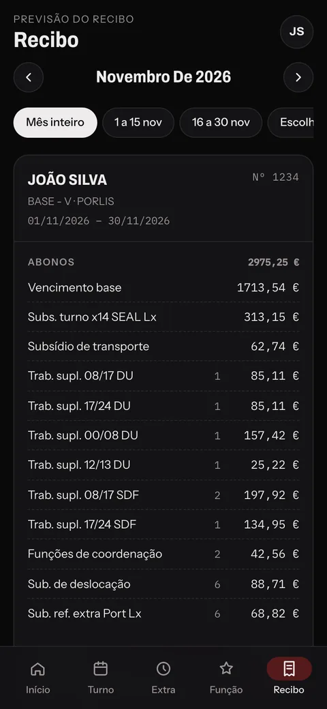<br><b>Recibo</b><br><sub>Mês ou quinzena, partilha em PDF</sub></td>
<td align="center">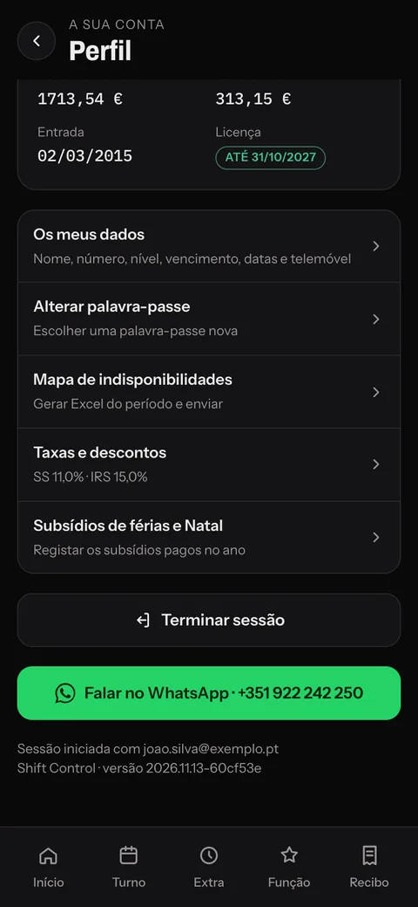<br><b>Perfil</b><br><sub>Taxas, subsídios, WhatsApp e versão</sub></td>
</tr>
</table>

<details>
<summary><b>🌗 Tema claro</b></summary>
<br>

| Início | Turno | Recibo | Perfil |
| :---: | :---: | :---: | :---: |
| 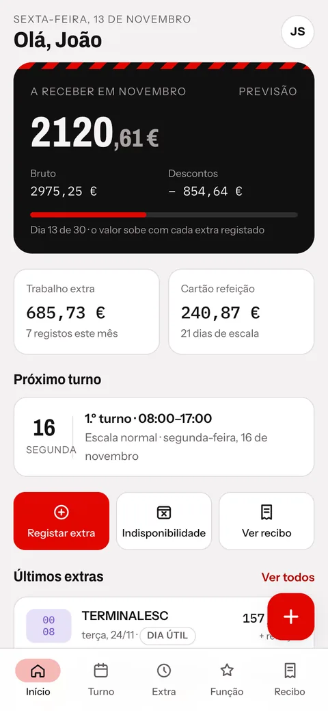 | 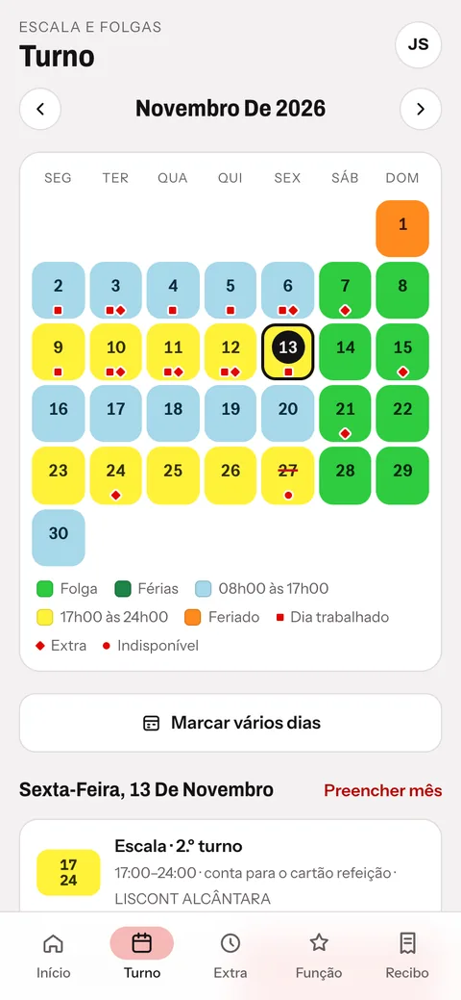 | 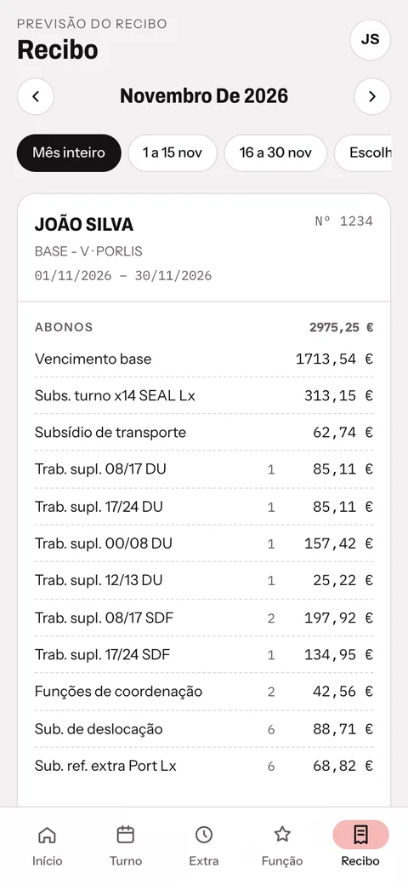 | 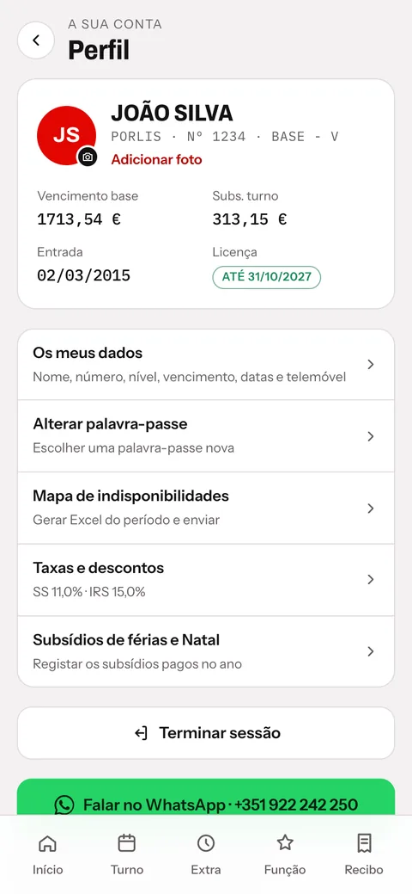 |

</details>

<details>
<summary><b>💻 No computador</b></summary>
<br>

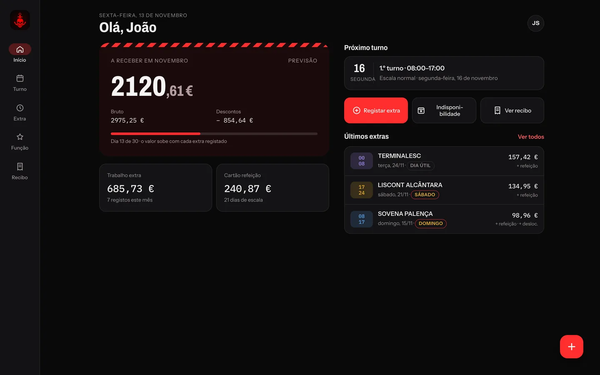

</details>

<br>

## 🗂️ O que há neste repositório

```text
shift-control-app/
├── index.html, assets/       o app (React, já construído e minificado)
├── sw.js, workbox-*.js       service worker: abre sem rede e atualiza-se sozinho
├── manifest.webmanifest      instalação como app (ícone, cores, ecrã inteiro)
├── ota/
│   ├── latest.json           versão atual e APK mais recente, lidos pelo app Android
│   └── app-<versão>.zip      pacote que o app Android descarrega e aplica
├── .well-known/              ligação com o app Android
└── docs/img/                 imagens deste README
```

### Porquê um repositório só com o app construído?
- **O código e as regras ficam privados**, e só o resultado é público (é o que o navegador descarrega de qualquer forma).
- **O GitHub Pages serve o app** em HTTPS, com cache, de graça e sem servidor próprio.
- **O app Android atualiza-se a partir daqui**, sem lojas nem serviços de terceiros: lê `ota/latest.json`, descarrega o `.zip`, aplica-o e, se a versão nova não abrir em 10 s, volta à anterior.

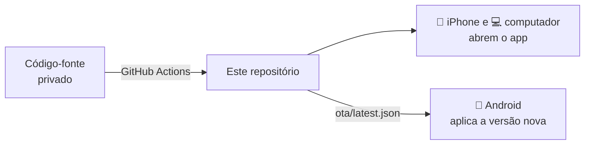

<br>

## 🔒 Privacidade

- Este repositório **não tem dados de ninguém**. Os registos ficam no banco de dados, protegidos por regras de acesso por pessoa.
- A chave do banco que aparece no código é a chave **pública** (*publishable*). A proteção está nas regras do banco.

<br>

<div align="center">
<sub>Shift Control · <a href="https://marloon-dev.github.io/shift-control-site/">Instalar</a> · <a href="https://wa.me/351922242250">WhatsApp +351 922 242 250</a></sub>
</div>
